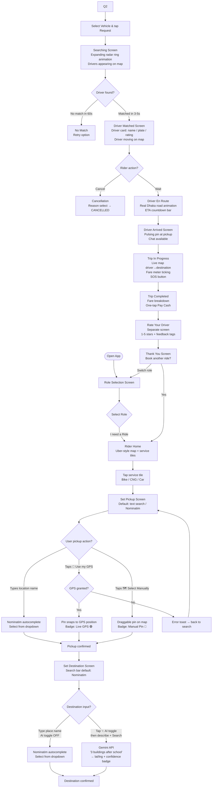
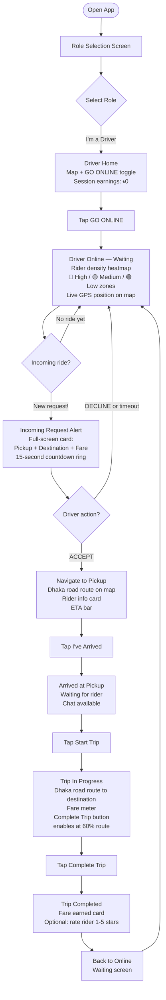
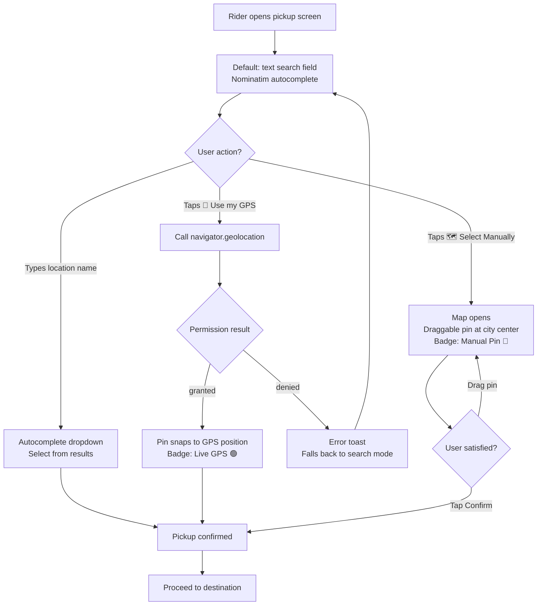
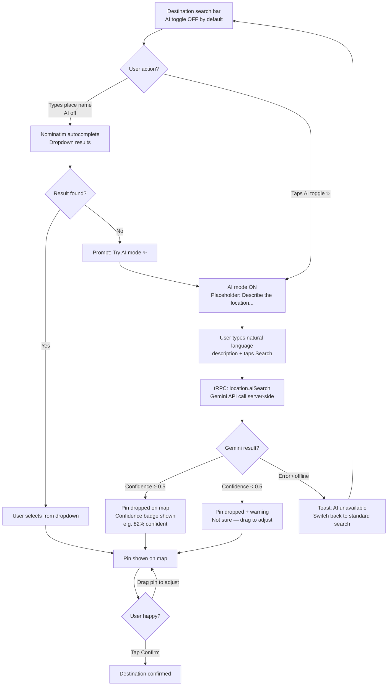
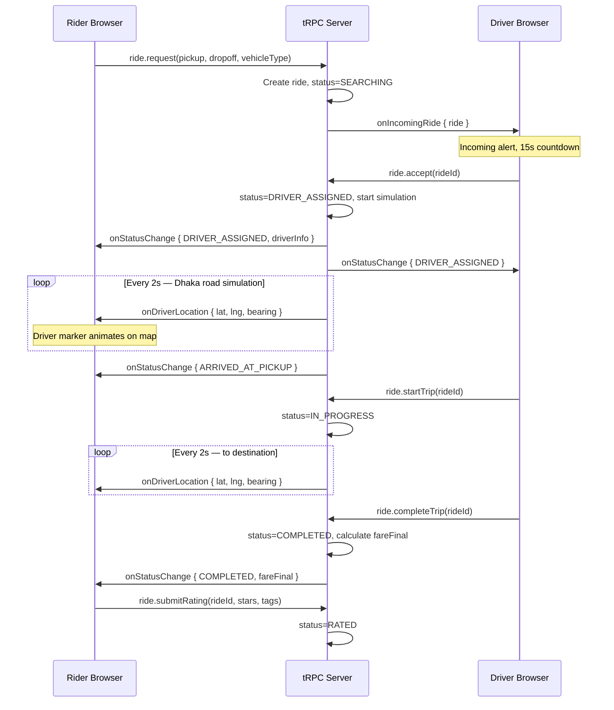

# GariKoi — Ride-Sharing PWA Demo: Design Document

**Date:** 2026-10-26 | **Status:** Approved (v3 — GariKoi)

---

## 1. Intent & Why

A fully working ride-sharing Progressive Web App (PWA) demo named **GariKoi** (গাড়ী কই?) that showcases the complete Rider ↔ Driver interaction loop — from booking through live tracking to completion. The primary differentiator is **flexible location access for Riders**: the pickup/source location input supports both live GPS and a manual map pin. Drivers always use GPS (server-side simulation takes over if GPS is unavailable). No step in any flow is blocked.

Design philosophy: **Utilitarian, clean, solid, and grounded**. Strictly avoid purple/violet shades, neon blues, AI gradients, or glossy artificial effects. High-contrast solid dark/neutral backgrounds, crisp typography, clean solid green accent (`#006a4e` / emerald), and functional status indicators.

This is a demo — no authentication, no accounts, no real payments.

---

## 2. Goals

- Complete end-to-end ride lifecycle: role selection → booking → matching → driver en-route → pickup → trip → completion → rating.
- **Uber-style Rider home**: central map with service tiles, destination search, offers strip.
- **AI-powered natural language location search**: "3 buildings after the school" → returns lat/lng.
- **Real Dhaka road waypoints** for driver simulation so movement looks authentic.
- **Rider density heatmap** for online Drivers to see where demand is concentrated.
- Installable PWA on mobile browsers.

---

## 3. Non-Goals

- Authentication, accounts, or user profiles.
- Real payment processing (fare shown, payment is a one-tap simulation).
- Production-grade geospatial indexing.
- Push notifications (WebSocket-only real-time).
- Food/parcel services.
- Multi-language support.

---

## 4. Anti-Goals

- Any flow that hard-blocks without GPS.
- A driver marker that never moves.
- A UI too sparse to feel like a real app.

---

## 5. Tech Stack

| Layer | Choice | Why |
|-------|--------|-----|
| Framework | **Next.js 14+** (App Router) | PWA, SSR, routing |
| API | **tRPC v11** | Type-safe + WebSocket subscriptions |
| Database | **SQLite via Prisma** | Zero-config, file-based |
| Maps | **MapLibre GL JS + OpenFreeMap tiles** | WebGL vector tiles, no API key, built-in heatmap + smooth animation |
| AI Location | **Google Gemini API** (gemini-1.5-flash) | Natural language → coordinates |
| Styling | **Tailwind CSS + shadcn/ui** | Fast, mobile-friendly |
| Real-time | **tRPC subscriptions + EventEmitter** | No broker needed at demo scale |
| PWA | **next-pwa** | Service worker, manifest |
| Session | **`localStorage` ephemeral sessionId** | No auth, zero friction |

---

## 6. Approach Selected

**Next.js + tRPC + SQLite + WebSocket subscriptions.** Backend holds authoritative ride state. tRPC subscriptions push updates to Rider and Driver in real time. Driver simulation runs server-side along real Dhaka road waypoints. One command (`pnpm dev`) to run everything.

---

## 7. Location Permission Model

### Rider Only — Pickup & Source Location

```
RIDER — Setting Pickup Location
────────────────────────────────
Default: Text search field (location name / place name via Nominatim).

Two opt-in overrides available via explicit buttons:

  [🗺 Select Manually]  → Switches to map + draggable pin mode.
                           Badge: "Manual Pin 📍"
                           User drags pin, taps Confirm.

  [📍 Use my GPS]       → Attempts Geolocation API.
                           ├─ GRANTED: pin snaps to current position.
                           │   Badge: "Live GPS 🟢"
                           └─ DENIED: shows error toast.
                               Falls back to search mode.

RIDER — Setting Destination
────────────────────────────
Text search field (Nominatim autocomplete) by default.
AI mode is an opt-in toggle within the search bar (see §8).
No GPS or pin involved for destination.

DRIVER — All location uses
───────────────────────────
GPS only. No manual pin.
If GPS unavailable → server-side simulation
along pre-defined Dhaka road waypoints takes over.
```

---

## 8. AI-Powered Location Search

AI mode is **opt-in** — the search bar defaults to standard location name search (Nominatim autocomplete). A toggle inside the search bar activates natural language mode.

### Search Bar UI (Destination Field)

```
┌─────────────────────────────────────────┐
│ 🔍  Search destination...          [✨AI]│  ← toggle button, off by default
└─────────────────────────────────────────┘

When AI toggle is OFF (default):
  → Standard Nominatim place name autocomplete
  → Dropdown of matching Dhaka locations as user types

When AI toggle is ON (✨ highlighted):
  → Placeholder changes to "Describe the location…"
  → User types natural language: "3 buildings after Dhanmondi 27 school"
  → Sends to Gemini API on submit (not on every keystroke)
  → Result shown as a single pin with confidence badge
```

### AI Resolution Flow

```
User taps [✨AI] toggle → mode activates
User types: "3 buildings after Dhanmondi 27 school, left side"
User taps Search (or hits Enter)
     │
     ▼
tRPC mutation: location.aiSearch({ query, contextLatLng? })
     │
     ▼
Server calls Gemini API:
  System: "You are a Dhaka, Bangladesh location resolver.
           Given a natural language place description, return
           the best matching coordinates.
           Respond ONLY as JSON: { lat, lng, displayName, confidence }"
     │
     ▼
Gemini returns: { lat: 23.7461, lng: 90.3742,
                  displayName: "Dhanmondi 27 vicinity",
                  confidence: 0.82 }
     │
     ▼
Map shows pin + card: "Dhanmondi 27 vicinity  ✨ 82% confident"
User taps Confirm, or drags pin to fine-tune.
```

### Fallback Chain (inside AI mode)
1. Gemini resolves → pin dropped with confidence badge.
2. Gemini low confidence (< 0.5) → shows warning: "Not sure about this location — drag the pin to adjust."
3. Gemini error / offline → toast: "AI unavailable, switched to standard search."

### Standard mode fallback chain
1. Nominatim autocomplete for place names.
2. If no result: prompt "Try AI mode for natural language search ✨".

### tRPC Procedure
```ts
location.aiSearch(input: { query: string; contextLat?: number; contextLng?: number })
  → { lat: number; lng: number; displayName: string; confidence: number }
```

### Tech Note
- Gemini API key in `.env.local` as `GEMINI_API_KEY` — server-side only.
- AI call fires on explicit submit, not on every keystroke (no debounce needed).
- Toggle state is per-session in component state (not persisted).

---

## 9. Role Selection

Full-screen splash on every cold-start or "Switch Role":

```
┌──────────────────────────────────┐
│         🏍  GariKoi              │
│                                  │
│   I want to...                   │
│                                  │
│   [ 🙋 I need a Ride  ]          │
│   [ 🚗 I'm a Driver   ]          │
└──────────────────────────────────┘
```

Role stored in `localStorage`. "Switch Role" header button clears active ride state after confirmation.

---

## 10. Ride State Machine

Server owns state. Clients send intentions; server emits transitions.

```
IDLE
 │  Rider: requestRide()
 ▼
SEARCHING  ──(60s timeout / rider cancels)──► CANCELLED
 │  System: auto-matches in 3–5s
 ▼
DRIVER_ASSIGNED
 │  Driver: startNavigation()
 ▼
DRIVER_EN_ROUTE   ← Dhaka road simulation begins
 │  [auto] driver reaches pickup coords
 ▼
ARRIVED_AT_PICKUP
 │  Driver: startTrip()
 ▼
IN_PROGRESS       ← simulation continues to destination
 │  Driver: completeTrip()
 ▼
COMPLETED
 │  Rider: submitRating()   [separate rating screen]
 ▼
RATED / CLOSED
```

Cancellation allowed for both sides from `DRIVER_ASSIGNED` and `DRIVER_EN_ROUTE`.

---

## 11. Vehicle Types & Fare

| Type | Icon | Base Fare | Per KM | Min Fare | Seats |
|------|------|-----------|--------|----------|-------|
| Bike | 🏍 | ৳30 | ৳12/km | ৳50 | 1 |
| CNG Auto | 🛺 | ৳40 | ৳15/km | ৳70 | 3 |
| Car | 🚗 | ৳80 | ৳22/km | ৳120 | 4 |

`Fare = max(minFare, baseFare + distanceKm × 1.3 × ratePerKm)`

---

## 12. All Screens

### Rider Screens

| ID | Screen | Key Elements |
|----|--------|-------------|
| R1 | **Role Selection** | Full-screen, two large role buttons |
| R2 | **Rider Home** | Full-screen map; top search bar "Where to?"; horizontal service tiles (Bike / CNG / Car) with icons; offers/promo strip at bottom; nearby driver dots on map |
| R3 | **Set Pickup Location** | Default: text search field (Nominatim autocomplete for Dhaka places); two explicit override buttons below: **"📍 Use my GPS"** (attempts geolocation, badge: Live GPS 🟢) and **"🗺 Select Manually"** (switches to map + draggable pin, badge: Manual Pin 📍); confirm CTA |
| R4 | **Set Destination** | Search bar with **[✨ AI]** toggle button (off by default); default mode: Nominatim autocomplete dropdown; AI mode: placeholder "Describe the location…", fires on submit, shows result pin with confidence badge; user can drag pin to fine-tune |
| R5 | **Fare Estimate** | Route polyline on map; 3 vehicle cards (icon, type, fare, ETA); selected card highlighted; "Request [Type]" CTA |
| R6 | **Searching** | Map with **expanding animated ring** from pickup point showing search radius; driver silhouettes appearing/disappearing; cancel button; auto-matches in 3–5s |
| R7 | **Driver Matched** | Driver card (avatar, name, vehicle, plate, rating ★); driver marker on map moving toward pickup; ETA pill; chat button; call button; cancel option |
| R8 | **Driver En Route** | Driver marker animating toward pickup along Dhaka roads; ETA countdown bar at top; "Driver is on the way" status |
| R9 | **Driver Arrived** | "Driver has arrived!" banner; pulsing pin at pickup; driver card with "I'm here" note; chat button |
| R10 | **Trip In Progress** | Full-screen map; driver moving toward destination; live fare meter ticking up; trip timer; SOS floating button |
| R11 | **Trip Completed** | Confetti; fare breakdown card (base + distance + total); "Pay ৳X (Cash)" one-tap button |
| R12 | **Rate Your Driver** | *(Separate screen)* Star selector (1–5); feedback tags (Polite / Safe Driver / Good Route / etc.); optional comment; "Submit Rating" |
| R13 | **Rated / Done** | "Thanks for riding!" screen; session earnings shown; "Book another ride" button |

### Driver Screens

| ID | Screen | Key Elements |
|----|--------|-------------|
| D1 | **Role Selection** | Same as R1, selects Driver |
| D2 | **Driver Home (Offline)** | Map; large "GO ONLINE" toggle; session earnings widget (৳0); vehicle type indicator |
| D3 | **Driver Online (Waiting)** | Map with **rider density heatmap** overlay (colour-coded zones: red = high demand, green = low); pulsing "Waiting…" status; "Go Offline" toggle; session fare earned today |
| D4 | **Incoming Request** | Full-screen alert slides up: pickup name, destination name, distance to pickup, estimated payout, vehicle type; **15-second countdown ring**; ACCEPT (green) / DECLINE (red) |
| D5 | **Navigate to Pickup** | Map: driver → pickup route along Dhaka roads; rider info card (name, avatar); distance + ETA top bar; "I've Arrived" button; chat button |
| D6 | **Arrived at Pickup** | "Waiting for rider" card; "Start Trip" CTA; cancel with reason option |
| D7 | **Trip In Progress** | Map: driver → destination; fare meter; "Complete Trip" button (enabled after 60% of route elapsed) |
| D8 | **Trip Completed** | Fare earned card; optional 1–5 star rating for rider; "Back online" button |

---

## 13. In-App Chat

Available during `DRIVER_ASSIGNED`, `DRIVER_EN_ROUTE`, `ARRIVED_AT_PICKUP`.

- Bottom sheet, message bubbles per role.
- **Quick replies:** "I'm outside", "On my way", "5 minutes", "Please wait", "Which gate?".
- Free-text input.
- Delivered via same tRPC subscription channel as ride updates.

---

## 14. Driver Location Simulation — Real Dhaka Road Waypoints

Driver movement follows **pre-encoded real road coordinate sequences** through Dhaka, not straight lines.

### Seed Routes (hardcoded polylines from actual OSM road data)

**Route A — Gulshan 2 → Banani → Mohakhali:**
```
[23.7938, 90.4143] → [23.7925, 90.4089] → [23.7901, 90.4062]
→ [23.7876, 90.4021] → [23.7854, 90.3998] → [23.7831, 90.3977]
```

**Route B — Dhanmondi 27 → Mirpur Road → Farmgate:**
```
[23.7461, 90.3742] → [23.7512, 90.3768] → [23.7558, 90.3791]
→ [23.7601, 90.3812] → [23.7649, 90.3834] → [23.7697, 90.3871]
```

**Route C — Motijheel → Paltan → Press Club → Shahbagh:**
```
[23.7233, 90.4185] → [23.7268, 90.4152] → [23.7291, 90.4118]
→ [23.7318, 90.4089] → [23.7342, 90.4061] → [23.7371, 90.4032]
```

**Route D — Uttara → Airport Road → Banani:**
```
[23.8729, 90.3984] → [23.8621, 90.4012] → [23.8512, 90.4034]
→ [23.8398, 90.4058] → [23.8289, 90.4079] → [23.8103, 90.4125]
```

### Simulation Logic

1. On `DRIVER_EN_ROUTE`: server picks the nearest seed route origin to the driver's start position.
2. Route is interpolated: waypoints snapped to pickup, then extended to dropoff using the nearest continuation.
3. `setInterval` every **2 seconds** advances position by one interpolated step.
4. Emits `driverLocationUpdate` with `{ lat, lng, bearing }` via tRPC subscription.
5. Rider map smoothly animates marker via CSS transitions.
6. Server auto-triggers `ARRIVED_AT_PICKUP` when driver is within **50m** of pickup coordinates.
7. If Driver client sends real GPS coordinates via `ride.updateDriverLocation`, they **override** simulation for that tick.

---

## 15. Rider Density Heatmap (Driver View)

Shown on the Driver's map when **Online (D3)**.

- Server maintains an in-memory map of `{ geohash → riderRequestCount }` per 5-minute window.
- Each `ride.request` increments the geohash cell of the pickup location.
- Driver subscribes to `driver.onDensityUpdate` which pushes updated heat data every 30 seconds.
- MapLibre GL JS **heatmap layer** (built-in, no plugin) renders colour-coded zones on the driver's map.
- Colour scale: 🟢 Low → 🟡 Medium → 🔴 High demand.
- Helps drivers reposition to high-demand zones.

New tRPC subscription:
```ts
driver.onDensityUpdate() → { cells: Array<{ lat, lng, intensity }> }
```

---

## 16. Data Model

```prisma
model Ride {
  id              String      @id @default(cuid())
  status          RideStatus  @default(SEARCHING)
  vehicleType     VehicleType
  pickupLat       Float
  pickupLng       Float
  pickupAddress   String
  dropoffLat      Float
  dropoffLng      Float
  dropoffAddress  String
  fareEstimate    Float
  fareFinal       Float?
  distanceKm      Float
  riderSessionId  String
  driverSessionId String?
  driverName      String?
  driverVehicle   String?
  driverPlate     String?
  driverRating    Float?      @default(4.8)
  driverRatingByRider Int?
  createdAt       DateTime    @default(now())
  updatedAt       DateTime    @updatedAt
  messages        ChatMessage[]
}

model ChatMessage {
  id         String   @id @default(cuid())
  rideId     String
  senderRole Role
  text       String
  createdAt  DateTime @default(now())
  ride       Ride     @relation(fields: [rideId], references: [id])
}

enum RideStatus {
  SEARCHING DRIVER_ASSIGNED DRIVER_EN_ROUTE
  ARRIVED_AT_PICKUP IN_PROGRESS COMPLETED CANCELLED RATED
}
enum VehicleType { BIKE CNG CAR }
enum Role { RIDER DRIVER }
```

---

## 17. tRPC API Surface

### Mutations
| Procedure | Caller | Action |
|-----------|--------|--------|
| `ride.request` | Rider | Create ride → SEARCHING |
| `ride.cancel` | Rider/Driver | Cancel with reason |
| `ride.accept` | Driver | → DRIVER_ASSIGNED |
| `ride.decline` | Driver | Re-queue in SEARCHING |
| `ride.startNavigation` | Driver | → DRIVER_EN_ROUTE |
| `ride.arrivedAtPickup` | Driver | → ARRIVED_AT_PICKUP |
| `ride.startTrip` | Driver | → IN_PROGRESS |
| `ride.completeTrip` | Driver | → COMPLETED, set fareFinal |
| `ride.submitRating` | Rider | → RATED |
| `ride.updateDriverLocation` | Driver | Override simulation with real GPS |
| `chat.sendMessage` | Both | Add chat message |
| `location.aiSearch` | Rider | Natural language → `{ lat, lng, displayName, confidence }` |

### Subscriptions
| Procedure | Subscriber | Emits |
|-----------|------------|-------|
| `ride.onStatusChange` | Both | `{ rideId, status, ...fields }` |
| `ride.onDriverLocation` | Rider | `{ lat, lng, bearing }` |
| `ride.onIncomingRide` | Driver | `{ ride }` |
| `chat.onMessage` | Both | `{ message }` |
| `driver.onDensityUpdate` | Driver | `{ cells: [{lat, lng, intensity}] }` |

### Queries
| Procedure | Caller | Description |
|-----------|--------|-------------|
| `ride.getActive` | Both | Fetch active ride by sessionId |
| `ride.getById` | Both | Full ride details |

---

## 18. Folder Structure

```
d:\humpty\
├── src/
│   ├── app/
│   │   ├── layout.tsx
│   │   ├── page.tsx                    # Role selection
│   │   ├── rider/page.tsx
│   │   └── driver/page.tsx
│   ├── components/
│   │   ├── map/
│   │   │   ├── MapBase.tsx             # Shared MapLibre GL JS <Map> wrapper (dynamic import, SSR disabled)
│   │   │   ├── LocationPicker.tsx      # GPS-or-pin (Rider pickup only) — renders MapBase
│   │   │   ├── RiderMap.tsx            # Rider tracking map — MapLibre source + layers
│   │   │   ├── DriverMap.tsx           # Driver map — MapLibre source + layers
│   │   │   ├── DriverMarker.tsx        # GeoJSON source + symbol layer, MapLibre interpolation
│   │   │   ├── RouteLayer.tsx          # GeoJSON LineString layer for route polyline
│   │   │   ├── SearchRadarOverlay.tsx  # CSS keyframe ring animation over map (R6)
│   │   │   └── DensityHeatmap.tsx      # MapLibre built-in heatmap layer (D3)
│   │   ├── rider/
│   │   │   ├── HomeScreen.tsx          # R2: Uber-style central home
│   │   │   ├── ServiceTiles.tsx        # Bike / CNG / Car tiles
│   │   │   ├── OffersStrip.tsx         # Promo offers bar
│   │   │   ├── LocationSearch.tsx      # AI search field + autocomplete
│   │   │   ├── FareSelector.tsx        # R5: vehicle cards
│   │   │   ├── SearchingOverlay.tsx    # R6: radar animation
│   │   │   ├── DriverCard.tsx          # R7: matched driver info
│   │   │   ├── TripActiveHUD.tsx       # R10: en-route HUD
│   │   │   ├── TripCompleted.tsx       # R11: fare summary
│   │   │   └── RatingScreen.tsx        # R12: separate rating screen
│   │   ├── driver/
│   │   │   ├── OnlineToggle.tsx
│   │   │   ├── IncomingRideAlert.tsx   # D4: 15s countdown
│   │   │   ├── NavigateToPickup.tsx
│   │   │   ├── TripActiveDriver.tsx
│   │   │   └── TripCompletedDriver.tsx
│   │   └── chat/ChatPanel.tsx
│   ├── server/
│   │   ├── routers/
│   │   │   ├── ride.ts
│   │   │   ├── chat.ts
│   │   │   ├── location.ts             # AI search + geocoding
│   │   │   └── driver.ts               # Density heatmap
│   │   ├── simulation/
│   │   │   ├── locationSimulator.ts    # Movement engine
│   │   │   └── dhakaRoutes.ts          # Hardcoded Dhaka road waypoints
│   │   ├── ai/gemini.ts                # Gemini API client
│   │   ├── density/heatmapStore.ts     # In-memory geohash counter
│   │   ├── db.ts
│   │   ├── events.ts
│   │   └── trpc.ts
│   ├── hooks/
│   │   ├── useLocation.ts              # GPS-or-pin (Rider only)
│   │   ├── useSession.ts
│   │   └── useRideSubscription.ts
│   └── lib/
│       ├── geo.ts                      # Haversine, bearing, interpolation
│       ├── fare.ts
│       └── constants.ts
├── prisma/schema.prisma
├── public/manifest.json
└── .env.local                          # GEMINI_API_KEY
```

---

## 19. Simulated Driver Profiles (Seed)

| Name | Vehicle | Type | Plate | Rating |
|------|---------|------|-------|--------|
| Rahim Uddin | Honda CB Shine | Bike | DHA-1234 | 4.9 |
| Karim Mia | Bajaj RE Auto | CNG | MET-5678 | 4.7 |
| Sumon Ahmed | Toyota Axio | Car | DHA-9012 | 4.8 |
| Farhan Hossain | Hero Splendor | Bike | DHA-3456 | 4.6 |
| Nasir Khan | Toyota Axio | Car | CHI-7890 | 4.9 |

---

## 20. PWA Configuration

- `manifest.json`: name="GariKoi", short_name="GariKoi", theme_color="#000000", icons 192×192 and 512×512.
- Service worker: caches app shell; network-first for tRPC routes.
- Mobile viewport, safe-area-inset for iOS.

---

## 21. Builder Decisions (Left Open)

- Exact Tailwind color palette (suggest: slate-950 background, emerald-400 accent).
- MapLibre map style: use `https://tiles.openfreemap.org/styles/liberty` (free, no API key). Builder may swap to Protomaps or any other MapLibre-compatible style URL.
- Driver marker animation: use MapLibre's `easeTo` / `flyTo` with a GeoJSON point source updated on each `driverLocationUpdate` tick. No third-party animation library needed.
- OSRM for real routing polylines (optional network-dependent enhancement over seed waypoints).

---

## 22. User Flow Diagrams

### Rider Complete Flow



### Driver Complete Flow



### Location Permission Sub-Flow (Rider Pickup)



### AI Location Search Sub-Flow



### Real-Time Ride State Sync (Both Clients)


